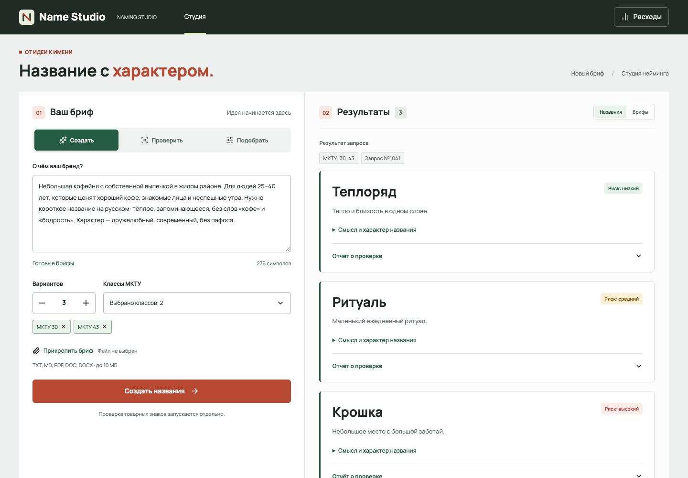
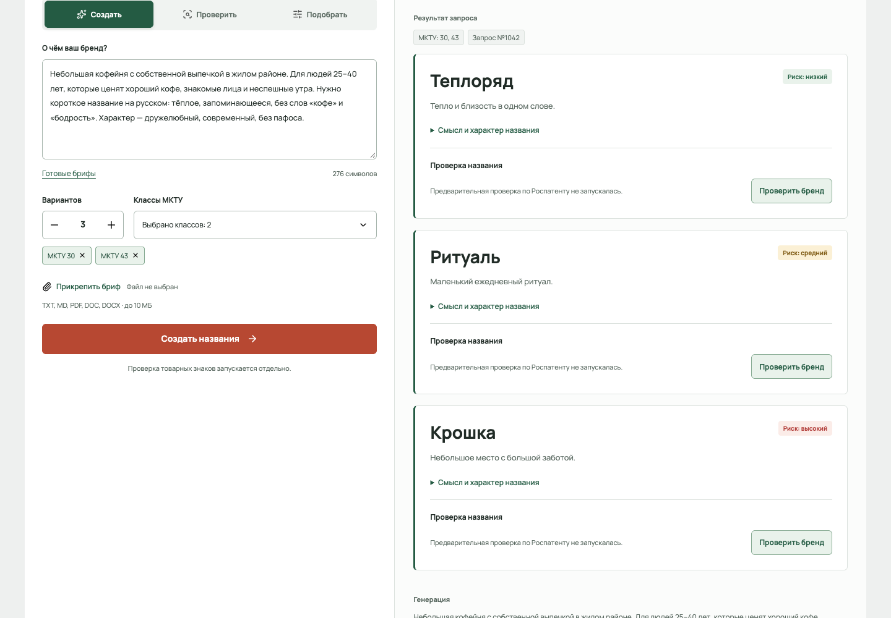
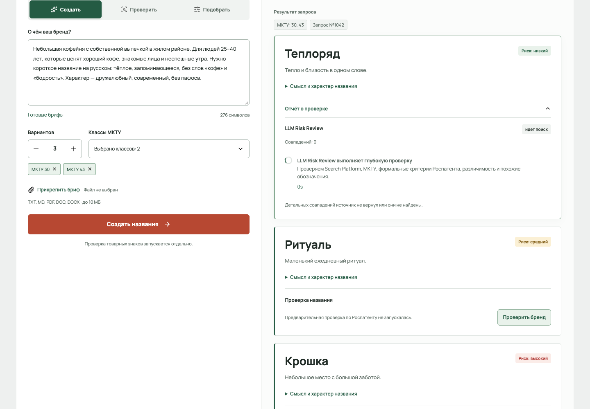

<a href="README.md">English</a> · <a href="README.ru.md">Русский</a>

<h1 align="center">Brand Naming Assistant</h1>

An AI-assisted naming concept that turns a creative brief into structured brand directions.

   

A public showcase of a private project, presenting anonymized interfaces and key workflows. Source code and internal project materials remain private.

## Key workflows

- Capture a creative brief
- Compare naming directions
- Review a candidate in context

## Gallery

Screens are presented individually with their proportions preserved. Identifying branding, contacts and data are replaced with demo content. These previews illustrate the product and do not imply a live service is available.

### Creative brief

### Naming directions

### Candidate review

---

[Explore all projects](https://github.com/svllvsx)
